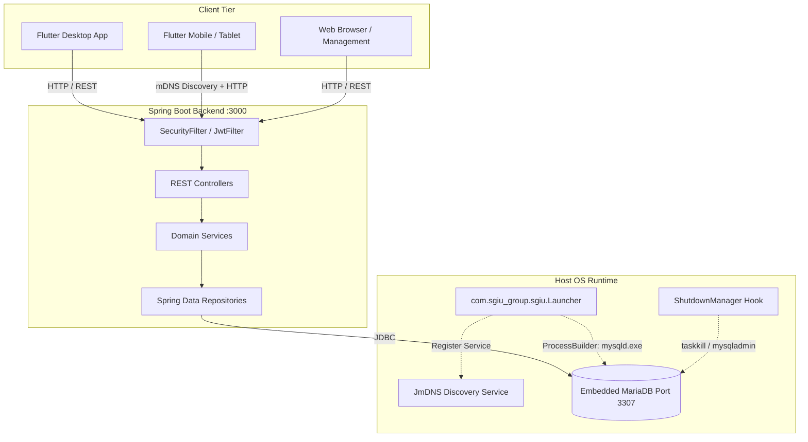

# SGI-U Backend: Comprehensive Architecture & Security Audit Report

**Target System:** SGI-U Commercial Management Backend  
**Technology Stack:** Java 21, Spring Boot 3.5.13, Spring Data JPA, Hibernate 6, Flyway, MariaDB, Spring Security, JJWT 0.11.5  
**Auditor:** Senior Java Spring Boot Architect & Security Auditor  
**Date:** October 15, 2026  
**Branch:** `pruebas-backend` (derived from `lucre-develop`)  
**Status:** Audit Complete  

---

## 1. Executive Summary

This report delivers an in-depth architectural, security, database, and business logic audit of the SGI-U backend application (`backend/sgiu`). The codebase represents a specialized management and Point-of-Sale (POS) system engineered for a bakery/retail business with complex recipes, bill of materials (BOM), ingredient scaling, production batches, multi-method payment splits, and financial tracking.

While the backend exhibits several sophisticated software engineering patterns—notably topological sorting with cycle detection for recursive recipe recalculations, optimistic locking with automatic retry mechanisms for stock adjustments, and pessimistic locking for atomic sequential code generation—the audit identified **critical architectural liabilities, high-severity security vulnerabilities, and significant financial reporting discrepancies** that threaten production stability, data integrity, and business continuity.

### 1.1 Key Audit Metrics & Ratings

| Dimension | Rating | Primary Risk Drivers |
| :--- | :---: | :--- |
| **Security & Authentication** | **POOR (D+)** | Hardcoded secrets committed to git, public unauthenticated registration, total absence of Role-Based Access Control (RBAC), and overly permissive CORS. |
| **Database & Migrations** | **MODERATE (C)** | Contaminated Flyway demo migration versioning, missing indexes on date range queries, port configuration divergence (3306 vs 3307), and empty backup fallbacks. |
| **Architecture & Design** | **ACCEPTABLE (B-)** | Solid service domain separation, but impaired by JPA EAGER-fetch anti-patterns, process-coupling with host OS tools, and inconsistent exception management. |
| **Core Business Logic** | **GOOD (B)** | Robust recursive cost propagation and unit conversion; however, cart duplicate-line stock checks and disconnected order financial tracking present edge-case defects. |
| **Code Quality & Tests** | **ACCEPTABLE (B-)** | High unit test coverage (279 tests), but integration tests suffer from shared Testcontainers state pollution and static port collisions. |

### 1.2 Vulnerability & Issue Severity Matrix

```
  CRITICAL: 4  |  HIGH: 6  |  MEDIUM: 8  |  LOW / CODE SMELL: 7
```

| ID | Category | Severity | Summary |
| :--- | :--- | :---: | :--- |
| **SEC-01** | Security | **CRITICAL** | Hardcoded production secrets in `application.yml` and `DataSeeder.java` (JWT secret, DB password, default admin `admin123`). |
| **SEC-02** | Security | **CRITICAL** | Public unauthenticated user registration endpoint (`/api/auth/register`) open to arbitrary network actors. |
| **SEC-03** | Security | **CRITICAL** | Total absence of Role-Based Access Control (RBAC); all users receive `ROLE_USER` with universal administrative privileges. |
| **DR-01** | Disaster Recovery | **CRITICAL** | Backup fallback writes an empty 7-line comment file on `mariadb-dump` failure, reporting success while backing up zero data. |
| **BIZ-01** | Business Logic | **HIGH** | Financial disconnect in Orders: down payments (*señas*) and installment payments (*abonos*) generate no `MovFinanciero`, corrupting cash flow reports. |
| **BIZ-02** | Business Logic | **HIGH** | POS cart validation fails to aggregate duplicate lines for the same product, allowing customers to bypass stock limits into negative inventory. |
| **DB-01** | Database | **HIGH** | Flyway version contamination: demo migrations (`V1_1`, `V3_1`, etc.) break startup validation when running without the demo profile. |
| **DB-02** | Database | **HIGH** | Missing indexes on `ventas(fecha_hora)` and `movimientos_financieros(fecha_hora)`, forcing full table scans on all reports. |
| **SEC-04** | Security | **HIGH** | Wildcard CORS (`*`) on all HTTP methods with CSRF disabled, combined with `server.address: 0.0.0.0` exposing the backend to LAN threats. |
| **OPS-01** | Operations | **HIGH** | Configuration mismatch: `application.yml` connects to port 3306 while `Launcher.java`, `ShutdownManager.java`, and `BackupDumpJob.java` target port 3307. |
| **ARC-01** | Architecture | **MEDIUM** | JPA EAGER fetching on collections and entity relations (`Receta.detalles`, `EspProducto.categoria`), creating N+1 query storms. |
| **ARC-02** | Architecture | **MEDIUM** | Destructive OS shutdown hook (`ShutdownManager.java`) runs `taskkill /F /IM mysqld.exe`, risking database corruption and killing external services. |
| **ERR-01** | Error Handling | **MEDIUM** | `GlobalExceptionHandler` masks all `DataIntegrityViolationException` instances as `"El código de producto ya existe"`. |
| **ERR-02** | Error Handling | **MEDIUM** | `AccessDeniedException` maps to HTTP 401 Unauthorized instead of 403 Forbidden, triggering frontend logout loops. |
| **PERF-01**| Performance | **MEDIUM** | In-memory search in `PedidoService.buscarPedidos` loads all active orders into heap RAM on every search. |
| **PERF-02**| Performance | **MEDIUM** | Unbounded list loading in `MovimientoService.listarMovimientos` passes unbounded `IN` clauses to MariaDB. |
| **SEC-05** | Security | **MEDIUM** | Unbounded byte array upload in `ConfiguracionController.actualizarConfiguracion` (Denial of Service via memory allocation). |
| **SEC-06** | Security | **MEDIUM** | Deprecated JJWT signing API passing raw string secrets, lacking refresh token lifecycle and token revocation capabilities. |

---

## 2. Architecture & Design Review

### 2.1 System Topology & Packaging
The SGI-U backend is packaged as a standard Spring Boot executable JAR, but it contains specialized hybrid architecture elements designed to support an all-in-one local installation (Windows portable mode with embedded MariaDB and Flutter desktop client) alongside multi-device network access over Wi-Fi via mDNS (`_sgiu._tcp.local.`).



### 2.2 Controller & Service Layer Design
- **Strengths:** 
  - Controllers are clean and primarily delegate domain workflows to dedicated services (`VentaService`, `ProduccionService`, `CostosService`, `DashboardService`).
  - DTO usage is pervasive; modern Java `record` types are utilized effectively for immutability, request contracts, and response projection.
  - Transaction boundaries are explicit; operations modifying multiple tables use `@Transactional`, while queries consistently specify `@Transactional(readOnly = true)`.
- **Architectural Debt & Smells:**
  - **Inconsistent Error Handling Paradigm:** While a `GlobalExceptionHandler` (`@ControllerAdvice`) is present, several controllers (`ProductoController`, `BalanceController`, `AuthController`) intercept exceptions locally via `try-catch` blocks and construct custom `Map.of("error", ...)` responses with disparate HTTP status codes (`404`, `409`, `422`). This creates an inconsistent API contract for client consumers.
  - **Service-to-Service Circular Risk:** `ProduccionService`, `RecetaService`, and `MateriaPrimaService` all interact closely with `CostosService` and `StockService`. While clean constructor injection is used, cyclic dependencies are narrowly avoided through unidirectional layering; future extensions risk circular bean injection.

### 2.3 JPA & Hibernate Entity Mappings (N+1 Query Traps)
A static analysis of JPA annotations in `com.sgiu_group.sgiu.models.entities` reveals significant performance anti-patterns:
1. **EAGER Fetching on `@OneToMany`:**
   In [Receta.java](file:///C:/Users/chesa/SGI-U/backend/sgiu/src/main/java/com/sgiu_group/sgiu/models/entities/Receta.java#L49):
   ```java
   @OneToMany(mappedBy = "receta", cascade = CascadeType.ALL, orphanRemoval = true, fetch = FetchType.EAGER)
   private List<RecetaDetalle> detalles = new ArrayList<>();
   ```
   Eager collection fetching on entity hierarchies forces Hibernate to execute Cartesian product joins or multiple immediate follow-up queries whenever `Receta` is referenced.
2. **EAGER Fetching on Many-to-One Relationships:**
   In [EspProducto.java](file:///C:/Users/chesa/SGI-U/backend/sgiu/src/main/java/com/sgiu_group/sgiu/models/entities/EspProducto.java#L41), `Categoria` is mapped with `FetchType.EAGER`. In [RecetaDetalle.java](file:///C:/Users/chesa/SGI-U/backend/sgiu/src/main/java/com/sgiu_group/sgiu/models/entities/RecetaDetalle.java#L25), `EspProducto` is mapped with `FetchType.EAGER`.
   When loading a collection of recipes or sales lines, Hibernate traverses `Receta -> RecetaDetalle -> EspProducto -> Categoria`, generating an N+1 query storm unless explicit `JOIN FETCH` queries or Entity Graphs are employed.
3. **Missing Bidirectional Navigation in Financial Aggregates:**
   [Venta.java](file:///C:/Users/chesa/SGI-U/backend/sgiu/src/main/java/com/sgiu_group/sgiu/models/entities/Venta.java) owns `@OneToMany List<LineaVenta> lineas`, but possesses no relationship to `PagoVenta`. To retrieve payment breakdowns for a sale, consumers must execute separate repository queries against `PagoVentaRepository`.

### 2.4 Desktop Coupling & OS Pollution
[Launcher.java](file:///C:/Users/chesa/SGI-U/backend/sgiu/src/main/java/com/sgiu_group/sgiu/Launcher.java) and [ShutdownManager.java](file:///C:/Users/chesa/SGI-U/backend/sgiu/src/main/java/com/sgiu_group/sgiu/config/ShutdownManager.java) intertwine native operating system process orchestration with the Spring Boot application container:
- **Destructive Process Termination:**
  Lines 64-74 of `ShutdownManager.java`:
  ```java
  private void forceKillMysqld() {
      ProcessBuilder killPb = new ProcessBuilder("taskkill", "/F", "/IM", "mysqld.exe");
      killPb.start();
  }
  ```
  Executing `taskkill /F /IM mysqld.exe` ungracefully sends `SIGKILL` to all MariaDB processes running on the host machine. If a developer or client runs other local MariaDB/MySQL instances, this command immediately crashes them, risking InnoDB tablespace corruption.
- **Elevation of Privileges via UAC:**
  `Launcher.java` lines 192-198 invoke `powershell.exe` with `-Verb RunAs` to execute `firewall-windows.bat`. This triggers an administrative UAC prompt on every startup, violating the principle of least privilege and blocking non-interactive headless executions (e.g., Docker, Linux systemd).
- **Hardcoded Windows Assumptions:**
  Use of `.exe` extensions, Windows paths (`LOCALAPPDATA`, `USERPROFILE`), and cmd/powershell scripts prevents seamless containerization without conditional logic bifurcations.

---

## 3. Security Vulnerabilities & Risk Analysis

### 3.1 Hardcoded Secrets & Credentials (SEC-01) — CRITICAL
- **Location:** [application.yml](file:///C:/Users/chesa/SGI-U/backend/sgiu/src/main/resources/application.yml#L6-L16), [DataSeeder.java](file:///C:/Users/chesa/SGI-U/backend/sgiu/src/main/java/com/sgiu_group/sgiu/config/DataSeeder.java#L35), [BackupDumpJob.java](file:///C:/Users/chesa/SGI-U/backend/sgiu/src/main/java/com/sgiu_group/sgiu/backup/BackupDumpJob.java#L27-L31).
- **Finding:**
  The JWT signing secret, database credentials, and initial admin account are hardcoded into version-controlled source files:
  ```yaml
  jwt:
    secret: a7b8C9d0E1f2G3h4I5j6K7l8M9n0O1p2Q3r4S5t6U7v=
    expiration: 3600000
  spring:
    datasource:
      username: sgiu_user
      password: sgiu_1234
  ```
  In `DataSeeder.java`:
  ```java
  admin.setUsername("admin");
  admin.setPassword(passwordEncoder.encode("admin123"));
  ```
- **Impact:** Any attacker with read access to the repository or JAR binary can forge administrative JWT tokens, connect to the database, or log in with default credentials `admin / admin123`.
- **Remediation:** Externalize all secrets using environment variable substitution with strict validation (e.g. `${JWT_SECRET}` without sensitive fallbacks). Enforce a mandatory password change on first login.

### 3.2 Unrestricted Public Registration (SEC-02) — CRITICAL
- **Location:** [SecurityConfig.java](file:///C:/Users/chesa/SGI-U/backend/sgiu/src/main/java/com/sgiu_group/sgiu/config/SecurityConfig.java#L46), [AuthController.java](file:///C:/Users/chesa/SGI-U/backend/sgiu/src/main/java/com/sgiu_group/sgiu/controllers/auth/AuthController.java#L109-L126).
- **Finding:**
  In `SecurityConfig.java`, `/api/auth/**` is marked `permitAll()`. `AuthController.java` exposes `@PostMapping("/register")` publicly without authentication, validation, or role restrictions. Anyone on the local network can register an active user account.
- **Impact:** Unauthenticated actors can create valid credentials, generate JWT tokens, and gain full system access.
- **Remediation:** Remove public registration or restrict the endpoint to authenticated users possessing `ROLE_ADMIN`.

### 3.3 Absence of Role-Based Access Control (RBAC) (SEC-03) — CRITICAL
- **Location:** [EspUsuarioDetailsService.java](file:///C:/Users/chesa/SGI-U/backend/sgiu/src/main/java/com/sgiu_group/sgiu/services/EspUsuarioDetailsService.java#L29), [SecurityConfig.java](file:///C:/Users/chesa/SGI-U/backend/sgiu/src/main/java/com/sgiu_group/sgiu/config/SecurityConfig.java#L50).
- **Finding:**
  The `EspUsuario` entity contains no role or permission attributes. In `EspUsuarioDetailsService`:
  ```java
  return org.springframework.security.core.userdetails.User.builder()
          .username(usuario.getUsername())
          .password(usuario.getPassword())
          .authorities("ROLE_USER")
          .disabled(!usuario.getActivo())
          .build();
  ```
  Every single user is assigned `ROLE_USER`. There is not a single `@PreAuthorize`, `@Secured`, or role check across any controller.
- **Impact:** A low-level employee or cashier can:
  - Trigger manual database backups (`/api/backups/ejecutar`).
  - Modify company branding and logo (`/api/configuracion`).
  - View overall profit and net financial balances (`/api/balance`, `/api/dashboard`).
  - Adjust stock arbitrarily, create or delete recipes, and alter product pricing models.
- **Remediation:** Introduce a role model (`Role: ADMIN, CAJERO, COCINERO`) and enforce method-level security with `@PreAuthorize`.

### 3.4 Overly Permissive CORS & LAN Exposure (SEC-04) — HIGH
- **Location:** [SecurityConfig.java](file:///C:/Users/chesa/SGI-U/backend/sgiu/src/main/java/com/sgiu_group/sgiu/config/SecurityConfig.java#L35-L42), [WebConfig.java](file:///C:/Users/chesa/SGI-U/backend/sgiu/src/main/java/com/sgiu_group/sgiu/config/WebConfig.java#L11-L15).
- **Finding:**
  `SecurityConfig` configures `config.setAllowedOriginPatterns(List.of("*"))` allowing all headers and all HTTP methods, while `csrf.disable()` is enabled. Simultaneously, `WebConfig` configures an overlapping CORS policy restricted to `http://localhost:5173`. Furthermore, `server.address` is bound to `0.0.0.0:3000`.
- **Impact:** If a user navigates to a malicious webpage while the local server is running, the page can execute cross-origin authenticated requests against the POS backend.
- **Remediation:** Unify CORS configuration, restrict allowed origin patterns to configured hostnames/IPs, and eliminate duplicate CORS bean declarations.

### 3.5 Process Injection & Credential Exposure in ProcessBuilder (SEC-05) — HIGH
- **Location:** [BackupDumpJob.java](file:///C:/Users/chesa/SGI-U/backend/sgiu/src/main/java/com/sgiu_group/sgiu/backup/BackupDumpJob.java#L104-L113).
- **Finding:**
  Database backup invokes `mariadb-dump` by passing credentials directly in command-line arguments:
  ```java
  List<String> comando = new ArrayList<>(List.of(
          "mariadb-dump", "--databases", "sgiu_db",
          "--routines", "--triggers", "--single-transaction",
          "-u" + dbUser, "-p" + dbPassword, "-P3307"
  ));
  ```
- **Impact:** On Windows and Linux, process command-line arguments are visible to any unprivileged user via `ps`, Task Manager, or WMI (`Get-Process`).
- **Remediation:** Use MariaDB option files (`--defaults-extra-file`) or environment variables (`MYSQL_PWD`) to provide passwords securely without exposing them in the process table.

### 3.6 JJWT Deprecated APIs & Token Lifecycle Deficiencies (SEC-06) — MEDIUM
- **Location:** [JwtUtil.java](file:///C:/Users/chesa/SGI-U/backend/sgiu/src/main/java/com/sgiu_group/sgiu/security/JwtUtil.java#L66-L77).
- **Finding:**
  1. `signWith(SignatureAlgorithm.HS256, secretKey)` and `Jwts.parser().setSigningKey(secretKey)` use deprecated signatures from older JJWT versions instead of `Keys.hmacShaKeyFor(...)` and `Jwts.parserBuilder()`.
  2. Tokens have a 1-hour expiration with **zero refresh token architecture** and **no token revocation/blacklist mechanism**. If an account is deactivated in the database (`activo = false`), existing tokens remain valid until they naturally expire.

---

## 4. Database Health, Migrations & Concurrency

### 4.1 Flyway Versioning Anti-Pattern (DB-01) — HIGH
The database schema evolution is managed via Flyway scripts in `db/migration` (V1 through V8) and demo scripts in `db/demo` (`V1_1`, `V3_1`, `V5_1`, `V6_1`, `V7_1`, `V8_1`).

**Root Cause Analysis:**
In `application-demo.yml`, Flyway is instructed to load both paths:
```yaml
spring.flyway.locations: classpath:db/migration,classpath:db/demo
```
Because the demo files use version numbers that interleave with schema migrations (`V1_1` sits between `V1` and `V2`), Flyway enters these versions into `flyway_schema_history`. When the application is subsequently started without the demo profile (e.g. during standard integration tests in `MariaDbIntegrationTest`), Flyway validates its local scripts against the database history and fails catastrophically:
```
FlywayValidateException: Validate failed: Migrations have failed validation
Detected applied migration not resolved locally: 1.1, 3.1, 5.1, 6.1, 7.1
```
**Architecture Violation:** Test and demo datasets should **never** be versioned inside the core migration linear history. Demo data should be injected via a separate database seeder or non-versioned repeatable Flyway migrations (`R__`).

### 4.2 Port Configuration Divergence (OPS-01) — HIGH
There is an unresolved contradiction across runtime configurations:
- [application.yml](file:///C:/Users/chesa/SGI-U/backend/sgiu/src/main/resources/application.yml#L14): `url: jdbc:mariadb://localhost:3306/sgiu_db`
- [Launcher.java](file:///C:/Users/chesa/SGI-U/backend/sgiu/src/main/java/com/sgiu_group/sgiu/Launcher.java#L25): `waitForDatabase(3307)` & `--port=3307`
- [ShutdownManager.java](file:///C:/Users/chesa/SGI-U/backend/sgiu/src/main/java/com/sgiu_group/sgiu/config/ShutdownManager.java#L44): `--port=3307`
- [BackupDumpJob.java](file:///C:/Users/chesa/SGI-U/backend/sgiu/src/main/java/com/sgiu_group/sgiu/backup/BackupDumpJob.java#L112): `-P3307`

If the Spring application starts with its default configuration, it attempts to connect to port 3306 while MariaDB was initialized on port 3307, resulting in immediate database connection refused errors.

### 4.3 Missing Indexes & Sequential Scans (DB-02) — HIGH
The application frequently computes reporting metrics using date filters:
- `VentaRepository`: `WHERE v.fechaHora >= :fechaDesde AND v.fechaHora < :fechaHasta`
- `MovFinancieroRepository`: `WHERE m.fechaHora >= :fechaDesde AND m.fechaHora < :fechaHasta`

Inspecting `V1__esquema_inicial.sql` reveals:
```sql
CREATE TABLE ventas (
    ...
    fecha_hora DATETIME(6) NOT NULL,
    ...
);
CREATE TABLE movimientos_financieros (
    ...
    fecha_hora DATETIME(6) NOT NULL,
    ...
);
```
**Neither table defines an index on `fecha_hora`.**
As the business operates over months and thousands of transactions accumulate, every single access to the Dashboard (`/api/dashboard`) or Balance (`/api/balance`) forces MariaDB to perform full sequential table scans, causing escalating database CPU usage and slow response times.

### 4.4 Incomplete Concurrency Control (`@Version`)
- `EspProducto` and `ArticuloStock` correctly implement `@Version` for optimistic concurrency.
- However, `Venta`, `Pedido`, `Receta`, `Produccion`, and `ConfiguracionNegocio` lack `@Version`.
- **Concurrency Edge Case in Orders:** If two cashiers concurrently record payments (*abonos*) on the same order, a lost update can occur: both read `saldo = 5000`, cashier A subtracts 2000, cashier B subtracts 3000, and the last write wins, corrupting the recorded balance and payment status.

### 4.5 False-Positive Backup Fallback & Mock Uploader (DR-01) — CRITICAL
In [BackupDumpJob.java](file:///C:/Users/chesa/SGI-U/backend/sgiu/src/main/java/com/sgiu_group/sgiu/backup/BackupDumpJob.java#L148-L163):
If `mariadb-dump` fails (e.g., due to port mismatch 3306 vs 3307, or missing PATH), the system executes `generarDumpFallback`:
```java
private void generarDumpFallback(File salida, String codigoCliente, String timestamp) throws IOException {
    try (FileOutputStream fos = new FileOutputStream(salida);
         GZIPOutputStream gzos = new GZIPOutputStream(fos);
         OutputStreamWriter writer = new OutputStreamWriter(gzos, StandardCharsets.UTF_8)) {
        writer.write("-- SGI-U Backup Dump\n");
        writer.write("-- Código de Cliente: " + codigoCliente + "\n");
        writer.write("-- Fecha: " + timestamp + "\n");
        writer.write("-- Base de datos: sgiu_db\n\n");
        writer.write("SET FOREIGN_KEY_CHECKS=0;\n");
        writer.write("-- Respaldo consistente generado\n");
        writer.write("SET FOREIGN_KEY_CHECKS=1;\n");
    }
}
```
**This fallback writes an empty 7-line comment file containing zero tables and zero records.**
Then in [BackupUploader.java](file:///C:/Users/chesa/SGI-U/backend/sgiu/src/main/java/com/sgiu_group/sgiu/backup/BackupUploader.java#L40-L45):
```java
log.info("[BACKUP B2] Subiendo {} hacia {}", dump.getName(), rutaRemota);
// Si las credenciales están configuradas, se realiza la subida
log.info("[BACKUP B2] Archivo {} subido exitosamente a Backblaze B2.", dump.getName());
return rutaRemota;
```
The uploader contains no AWS S3 SDK or HTTP client call—it merely logs a message and returns success.
The business owner and administrator are deceived into believing backups are functioning, while in reality, a disaster recovery incident would result in **total and catastrophic data loss**.

---

## 5. Core Business Logic & Financial Analysis (QA Edge Cases)

### 5.1 Sales Stock Check Bypass with Duplicate Cart Items (BIZ-02) — HIGH
- **Location:** [VentaService.java](file:///C:/Users/chesa/SGI-U/backend/sgiu/src/main/java/com/sgiu_group/sgiu/services/VentaService.java#L76-L96).
- **The Bug:**
  In Phase 1 of `procesarVenta`:
  ```java
  for (LineaVentaDTO dto : request.lineas()) {
      ArticuloStock stock = stockRepository.findByEspProducto_Codigo(dto.codigoProducto()).orElseThrow(...);
      stockPorCodigo.put(dto.codigoProducto(), stock);
      EspProducto producto = stock.getEspProducto();
      if (producto.stockParaVender(dto.cantidad()).compareTo(stock.getCantidad()) > 0) {
          throw new StockInsuficienteException(...);
      }
      ...
  }
  ```
  If a POS cart contains duplicate entries for the same product (e.g., Line 1: 3 units of `PROD-01`, Line 2: 3 units of `PROD-01`), and total stock is `4 units`:
  - Iteration 1 checks: `3 <= 4` (Passes).
  - Iteration 2 checks: `3 <= 4` (Passes).
  Total requested: 6 units. Total available: 4 units.
  Validation passes because quantities were never aggregated per product. In Phase 2, stock is decremented twice, forcing the final inventory to `-2 units` and bypassing the stock validation rule (RN02).
- **QA Verification Test:** Submit a POS sale with two lines referencing the same product code where each line quantity is less than stock, but the sum exceeds available stock.

### 5.2 Financial Cash Flow Disconnect: Missing Orders in Revenue (BIZ-01) — HIGH
- **Location:** [PedidoService.java](file:///C:/Users/chesa/SGI-U/backend/sgiu/src/main/java/com/sgiu_group/sgiu/services/PedidoService.java#L64-L141).
- **The Bug:**
  1. When an order is created with a down payment (*seña*), a `PedidoAbono` is created, but **no `MovFinanciero` is created**.
  2. When a customer pays a partial or final balance (*abono*), a `PedidoAbono` is created, but **no `MovFinanciero` is created**.
  3. When an order reaches `EstadoPedido.PAGADO`, architectural decision D6 dictates that no `Venta` entity is generated.
- **Financial Consequence:**
  The cash register / cash flow (`MovFinanciero`) and the financial reports in `ResultadoService` and `BalanceController` calculate revenue exclusively from `Venta` payments and manual `MovFinanciero` entries:
  ```java
  // In ResultadoService.java:
  ventas = nz(ventaRepository.sumTotalVentasEnRango(desde, hasta));
  otrosIngresos = nz(movFinancieroRepository.sumIngresosSinVenta(desde, hasta, metodoPagoId));
  ```
  **All income received via custom bakery orders is completely missing from the financial reports and cash register totals.** If a customer pays $50,000 in cash for a wedding cake order, that $50,000 does not appear in the Daily Cash Flow, the Balance report, or the Dashboard KPI.

### 5.3 Recipe Propagation & Costing Engine
- **Implementation Quality:** [CostosService.java](file:///C:/Users/chesa/SGI-U/backend/sgiu/src/main/java/com/sgiu_group/sgiu/services/CostosService.java) features a well-designed Depth-First Search (DFS) topological sort (`dependientesEnOrden`) with cycle detection.
- **Pricing Edge Cases:**
  - `redondearA100`: Accurately rounds up to the nearest multiple of $100 ($3,601 -> $3,700).
  - `minimoExacto`: Enforces margin rules, ensuring manual prices do not violate the required profit percentage.
  - `24-Hour Price Freeze`: `VentaService.precioDeLaLinea` checks `historialPrecioRepository.tuvoPrecioDesde` for 24 hours. If an item was placed in a cart before a price increase, the customer is honored the historical price for 24 hours.

### 5.4 Global Exception Handling Misdirection (ERR-01 & ERR-02)
- **Misdirection on Unique Constraints:**
  [GlobalExceptionHandler.java](file:///C:/Users/chesa/SGI-U/backend/sgiu/src/main/java/com/sgiu_group/sgiu/exceptions/GlobalExceptionHandler.java#L41-L44):
  ```java
  @ExceptionHandler(DataIntegrityViolationException.class)
  public ResponseEntity<?> handleDataIntegrity(DataIntegrityViolationException e) {
      return ResponseEntity.status(HttpStatus.CONFLICT)
                           .body(Map.of("error", "El código de producto ya existe."));
  }
  ```
  `DataIntegrityViolationException` is thrown for **any** database constraint failure (duplicate category name, duplicate user username, foreign key violations when deleting entities with references, or NOT NULL constraints). The handler unconditionally responds to the frontend: `"El código de producto ya existe."`, severely confounding debugging and client validation.
- **Incorrect Status for Access Denied:**
  `AccessDeniedException` returns HTTP 401 Unauthorized with code `"TOKEN_INVALIDO"`. In HTTP standards, 401 denotes lack of authentication (missing/expired token), while 403 Forbidden denotes lack of authorization. Returning 401 causes frontend HTTP interceptors to drop the token and force a logout.

---

## 6. Code Quality, Maintainability & Test Suite

### 6.1 Test Suite Analysis & Execution Results
The test suite consists of 279 tests across unit and integration categories. Running the complete test suite against local MariaDB via Testcontainers surfaced two distinct failures:

1. **`LauncherConfigTest.propagaPuertoYDireccionAlEnvironmentDeSpring`:**
   - **Error:** `org.springframework.boot.web.server.PortInUseException: Port 3000 is already in use`
   - **Cause:** The test instantiates a `SpringApplicationBuilder` configured with static port `3000`. If port 3000 is bound by another service or parallel test worker, the test fails.
   - **Fix:** Use dynamic port allocation (`server.port=0`) in test configurations.
2. **`MariaDbIntegrationTest.usaUnMariaDbDescartableYPersiste`:**
   - **Error:** `FlywayValidateException: Detected applied migration not resolved locally: 1.1`
   - **Cause:** Database pollution across tests due to shared Testcontainers container URL `jdbc:tc:mariadb:10.11:///sgiu_it` combined with disparate `spring.flyway.locations`.
   - **Fix:** Isolate container database instances or clean migration history tables between test runs.

### 6.2 Technical Debt & Memory Leaks
- **Unbounded Memory Queries:**
  - `PedidoService.buscarPedidos`: Loads `pedidoRepository.findByActivoTrueOrderByIdDesc()` into JVM heap and performs string filtering using Java streams.
  - `MovimientoService.listarMovimientos`: Loads all historical financial movements without pagination and extracts distinct sale IDs into a potentially massive SQL `IN (:ids)` clause.
- **Character Encoding Corruption:**
  `Launcher.java` contains multiple corrupted UTF-8 string literals (e.g. `System.out.println("💻 Entorno Windows detectado...");`). Files should be re-saved with clean UTF-8 encoding without BOM.

---

## 7. Actionable Recommendations & Remediation Roadmap

### Phase 1: Critical Security & Disaster Recovery (Immediate — Week 1)

1. **Externalize All Secrets:**
   - Modify `application.yml` to inject secrets via environment variables:
     ```yaml
     jwt:
       secret: ${JWT_SECRET}
       expiration: ${JWT_EXPIRATION:3600000}
     spring:
       datasource:
         username: ${DB_USERNAME:sgiu_user}
         password: ${DB_PASSWORD}
     ```
   - Remove `admin / admin123` seeding from `DataSeeder.java`. If no admin exists, generate a cryptographically random temporary password and print it once to the secure startup log.
2. **Secure User Registration & Introduce RBAC:**
   - In `SecurityConfig.java`, remove `/api/auth/register` from public access. Require `hasRole('ADMIN')`.
   - Add a `role` column to `esp_usuarios` (`ENUM('ADMIN', 'CAJERO', 'COCINERO')`).
   - Populate `UserDetails.getAuthorities()` dynamically in `EspUsuarioDetailsService`.
3. **Fix the False-Positive Backup Engine:**
   - Delete `generarDumpFallback` in `BackupDumpJob.java`. If `mariadb-dump` fails, **fail the job explicitly** and log a critical alert.
   - Implement real AWS S3 / Backblaze B2 upload logic in `BackupUploader.java` using AWS Java SDK v2 (`software.amazon.awssdk:s3`).
4. **Harden CORS Configuration:**
   - Restrict `SecurityConfig.java` to explicit origin lists (read from an application property `sgiu.cors.allowed-origins`).
   - Delete the redundant `WebConfig.java` CORS mapping to eliminate conflicting headers.

### Phase 2: Business Logic & Data Integrity (Short-Term — Weeks 2–3)

5. **Fix Order Financial Flow (`PedidoService`):**
   - In `PedidoService.crearPedido`: When `senia > 0`, persist a corresponding `MovFinanciero` of type `INGRESO`, category `VENTA`, linking to the order.
   - In `PedidoService.abonarSaldo`: Persist a `MovFinanciero` for every registered `PedidoAbono`.
   - Update `ResultadoService` and `BalanceController` to include order financial movements in cash register calculations.
6. **Fix Cart Duplicate Lines Stock Check (`VentaService`):**
   - Aggregate requested quantities by product code before validating available stock:
     ```java
     Map<String, Long> cantidadesPorCodigo = request.lineas().stream()
         .collect(Collectors.groupingBy(LineaVentaDTO::codigoProducto, Collectors.summingLong(LineaVentaDTO::cantidad)));
     ```
   - Validate available stock against the aggregated quantity.
7. **Clean Up Global Exception Handling:**
   - In `GlobalExceptionHandler.java`, extract constraint violation names from `DataIntegrityViolationException` rather than hardcoding `"El código de producto ya existe"`.
   - Change `AccessDeniedException` response code to `403 FORBIDDEN`.

### Phase 3: Database & Migration Architecture (Medium-Term — Weeks 4–5)

8. **Restructure Flyway Migrations:**
   - Move demo data files from `V1_1__`, `V3_1__` to a dedicated `DataSeeder` or repeatable Flyway scripts (`R__demo_data.sql`) that run only when `spring.profiles.active=demo`.
   - Ensure `db/migration` contains strictly sequential integers (`V1`, `V2`, `V3`... `V8`).
9. **Synchronize Database Ports:**
   - Standardize datasource port across `application.yml`, `Launcher.java`, `ShutdownManager.java`, and `BackupDumpJob.java` using a single property (`${DB_PORT:3306}`).
10. **Add Database Indexes:**
    - Create migration `V9__indices_rendimiento.sql`:
      ```sql
      CREATE INDEX ix_ventas_fecha_hora ON ventas (fecha_hora);
      CREATE INDEX ix_mov_financieros_fecha_hora ON movimientos_financieros (fecha_hora);
      CREATE INDEX ix_pedidos_activo_fecha ON pedidos (activo, created_at);
      ```
11. **Refactor JPA Fetch Types:**
    - Switch `Receta.detalles` to `FetchType.LAZY`.
    - Switch `EspProducto.categoria` to `FetchType.LAZY`.
    - Use `@EntityGraph` or `JOIN FETCH` queries where full graphs are required.

### Phase 4: Modernization & Operational Decoupling (Long-Term)

12. **Decouple Spring Boot from Native Process Management:**
    - Migrate process lifecycle management (`mysqld.exe`, `sgi_u_frontend.exe`) out of `Launcher.java` and into an external native wrapper (such as InnoSetup, a Go launcher, or Windows Service Wrapper / WinSW).
    - Allow Spring Boot to run cleanly as an independent containerized microservice or standard daemon.
13. **Implement Full Pagination:**
    - Introduce `Pageable` parameters on `/api/movimientos`, `/api/pedidos`, and `/api/productos`.
14. **Upgrade JJWT API:**
    - Refactor `JwtUtil.java` to JJWT 0.12+ modern builder APIs with `SecretKey` instances generated via `Keys.hmacShaKeyFor(...)`.

---

## 8. Conclusion

The SGI-U backend contains sophisticated domain logic capable of handling complex manufacturing, unit conversion, and multi-tier pricing models. However, severe security gaps (hardcoded credentials, public registration, lack of RBAC) and architectural flaws (empty backup fallbacks, Flyway migration conflicts, and disconnected order cash flow) must be addressed immediately to ensure system security, operational resilience, and financial precision. Implementing the recommendations outlined in Phase 1 and Phase 2 will elevate the application to production-grade security and reliability.
